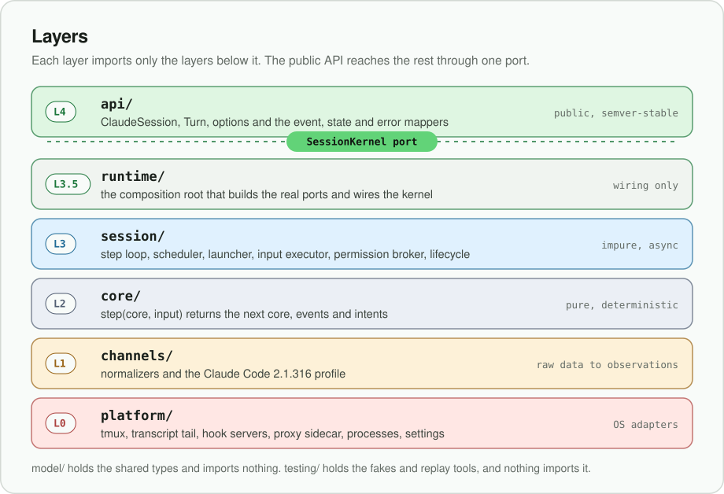
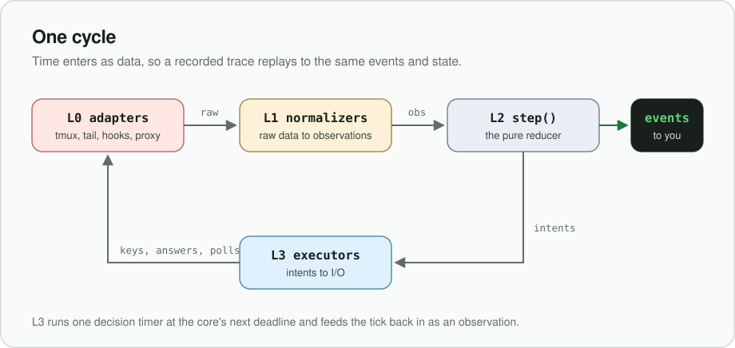
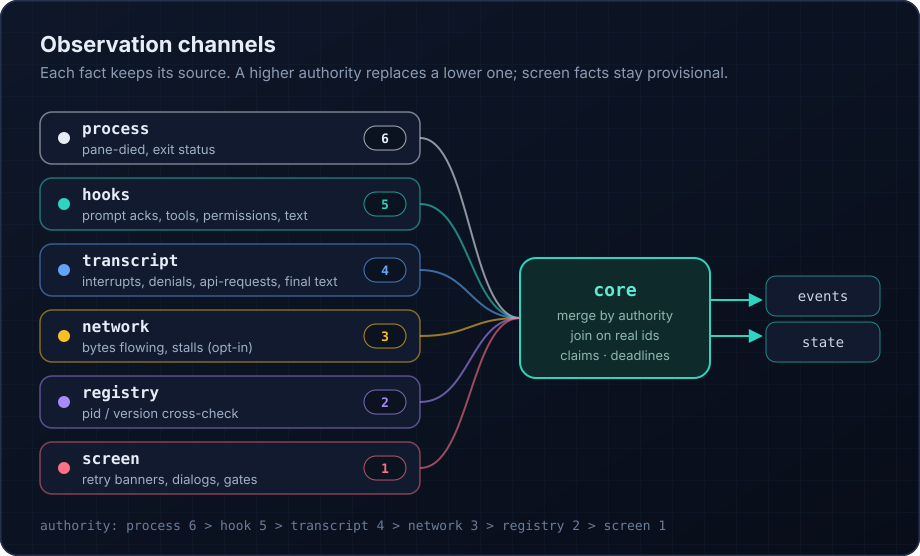

# Architecture

This document explains how `claude-code-driver` works inside: what problem each part solves, how data moves between
layers, which rules keep the design honest, and where to make a change. It is written for contributors and for anyone
evaluating whether to trust the library.

- **User guide**: [docs/USAGE.md](docs/USAGE.md). **Normative spec**: [docs/DESIGN.md](docs/DESIGN.md) (every MUST
  lives there; this document summarises it and points at code). **Change records**: [docs/icr/](docs/icr/).
- Source comments cite design sections as `§n.m`, decisions as `D-nn`, pitfalls as `P-AREA-nn` and change records as
  `ICR nnnn`, all in `docs/DESIGN.md` / `docs/icr/`. A few comments also cite internal research notes by short tag
  (`RC`, `TD`, `SP`, …); those notes are not published, and `DESIGN.md` carries every conclusion drawn from them.

---

## 1. The problem

Claude Code has two modes:

- **Headless** (`claude -p`, the Agent SDK) streams structured JSON, but it is billed as extra API usage rather than
  against a Claude subscription.
- **Interactive** (the TUI) uses the subscription, but it is built for a human at a terminal: there is no structured
  output, no API for "what is the agent doing right now", and input is keystrokes.

`claude-code-driver` runs the **interactive** TUI inside a private tmux server and rebuilds a structured, streaming,
programmable session on top of it: prompts in, typed events and a live state snapshot out, permissions answered from
code, interrupts, usage queries and clean shutdown.

The hard part is not driving the TUI. It is **knowing what is true**. No single signal tells the whole story:

| Question | Where the truth is |
|---|---|
| Did my prompt arrive? | the `UserPromptSubmit` hook (live, exact text) |
| Which tool is running, with what input? | `PreToolUse`/`PostToolUse` hooks (live, with real `tool_use_id`) |
| Was the turn interrupted? | only the transcript (`[Request interrupted by user]`), never a hook |
| Is the model thinking, or is the connection dead? | only network byte flow; the TUI's "thinking" label is time-based and lies during stalls |
| Is Claude retrying an API error, and when? | only the screen (`Retrying in 5s · attempt 4/10`) |
| Is a permission dialog up that no hook reported? | only the screen |

So the library is built as a **multi-source observation system** with an explicit trust order, feeding a **pure,
deterministic reducer** that owns all decisions. Everything else is adapters.

---

## 2. The big picture



The same picture in text:

```
                         ┌──────────────────────────────────────────────┐
  your code ── api ────▶ │ L4  api/          ClaudeSession, Turn         │  public, semver-stable
                         └──────────────┬───────────────────────────────┘
                                        │ SessionKernel port (model/kernel.ts) — the ONLY seam
                         ┌──────────────▼───────────────────────────────┐
                         │ L3.5 runtime/     composition root            │  builds real ports, wires L3
                         ├──────────────────────────────────────────────┤
                         │ L3  session/      orchestrator                │  step loop, scheduler, launcher,
                         │                   (impure, async)             │  input executor, permission broker,
                         │                                               │  lifecycle, registry, trace
                         ├───────────────┬──────────────────────────────┤
     commands ─────────▶ │ L2  core/     │  step(core, input) →         │  PURE: no I/O, no clock reads,
     observations ─────▶ │  (pure)       │   {core, events, intents}    │  no randomness, never throws
                         ├───────────────┴──────────────────────────────┤
                         │ L1  channels/     normalizers + profiles      │  raw bytes → semantic observations;
                         │                                               │  all version-specific strings live here
                         ├──────────────────────────────────────────────┤
                         │ L0  platform/     adapters                    │  tmux, fs tail, hook servers, proxy
                         │                                               │  sidecar, processes, settings, clock
                         └──────────────────────────────────────────────┘
                           model/  — shared types, branded ids, errors (imports nothing)
                           testing/ — fakes, replay, scenario DSL (imports anything; nothing imports it)
```

One cycle of the system:



1. An L0 adapter sees something (a hook POST, a new transcript line, a screen capture, tunnel bytes, a process exit).
2. An L1 normalizer turns it into zero or more **observations** (`tool.pre`, `turn.stopped`, `screen.frame`, …).
3. L3 stamps each observation with a sequence number and time and feeds it, one at a time, into the L2 reducer.
4. The reducer returns the new state, **domain events** to publish, and **intents** (instructions such as "press
   Escape", "answer permission p5 with deny", "capture the screen now").
5. L3 publishes the events (the facade maps them to public events) and executes the intents through L0, which in turn
   produces more observations, such as `input.done`.

Time enters only as data. The reducer never reads a clock. Every decision timer is a deadline in core state, and L3 runs
exactly one timer (at the next deadline) that feeds a `clock.tick` observation back in. This makes the whole decision
layer **replayable**: a recorded trace of observations reproduces the exact same events and final state.

---

## 3. Repository map

```
src/
  model/      types shared by every layer: ids, time, errors, observations, events, state, commands, intents, kernel port
  platform/   L0 adapters (each with a fake-*.ts next to it)
    tmux/          private tmux server per session: spawn, paste, keys, capture, status (execFile only)
    fs-tail/       transcript follower: poll + pread, byte-level line splitter, file discovery
    hook-server/   loopback HTTP + unix-socket hook servers in a worker thread; standalone command forwarder
    netproxy/      optional CONNECT pass-through sidecar (separate process) + client
    editor/        external-editor prompt injection ($VISUAL + Ctrl-G), standalone editor script
    process/       execFile wrapper, pid identity, owner-watch watchdog (separate process), which(1)
    settings/      Claude's settings layers, ~/.claude.json, trust, workspace inspection
    runtime-dir/   0700 runtime dir (sockets, settings, staging) and state dir (registry)
    clock/ ids/ env/ registry/   real clock, crypto ids, env reader, Claude's own session registry reader
    ports.ts       every L0 port interface (types only)
  channels/   L1 normalizers
    hooks/ transcript/ screen/ network/ registry/
    profiles/claude-2.1.316/   every string, regex and table specific to Claude Code 2.1.316
  core/       L2 pure reducer
    step.ts evolve.ts facts.ts lattice.ts claims.ts deadlines.ts closing.ts selectors.ts keys.ts
    decide/        per-entity decision logic (turns, tools, agents, permissions, model calls, session, usage, …)
    reconcile/     cross-source correlation (permission↔tool binding, spawn links, text matching, network)
    input-policy/  the input job state machine and the text sanitizer
    status/        derived AgentStatus
  session/    L3 orchestrator: kernel, loop, queue, scheduler, launcher, preflight, env/argv/settings builders,
              input executor, permission broker, pollers, tail driver, lifecycle, reaper, registry, redaction, trace
  runtime/    L3.5 composition root (node.ts) and the ./kernel subpath entry
  api/        L4 public facade: ClaudeSession, Turn, options, event/state/error mappers
  cli/        the `ccd` binary: lifecheck, view, trace
  testing/    the ./testing subpath: fakes aggregator, replay, scenario DSL, screen builders, arbitraries
test/
  unit/ arch/ kernel/ replay/ contract/ live/      (see §12)
fixtures/
  traces/ goldens/ screens/ verify/                recorded 2.1.316 behaviour (depersonalized), replay goldens
docs/  DESIGN.md (spec) · USAGE.md (guide) · KNOWN-LIMITATIONS.md · MANUAL-TESTS.md · icr/ (change records)
etc/   claude-code-driver.api.d.ts                 committed public API report (CI fails on drift)
site/  VitePress documentation site (GitHub Pages)
```

---

## 4. Layering

### 4.1 The dependency rule

Rows may import columns. Enforced by dependency-cruiser (`.dependency-cruiser.cjs`), per-layer ESLint import rules and
arch tests; CI fails on any violation.

| from \ to | model | platform | channels | core | session | runtime | api | cli | testing |
|---|---|---|---|---|---|---|---|---|---|
| **model** | self | ✗ | ✗ | ✗ | ✗ | ✗ | ✗ | ✗ | ✗ |
| **platform** | ✓ | self | ✗ | ✗ | ✗ | ✗ | ✗ | ✗ | ✗ |
| **platform/\*/standalone** | `node:*` only | ✗ | ✗ | ✗ | ✗ | ✗ | ✗ | ✗ | ✗ |
| **channels** | ✓ | type-only | self | ✗ | ✗ | ✗ | ✗ | ✗ | ✗ |
| **core** | ✓ | ✗ | ✗ | self | ✗ | ✗ | ✗ | ✗ | ✗ |
| **session** | ✓ | type-only (`ports.ts`) | ✓ | ✓ | self | ✗ | ✗ | ✗ | ✗ |
| **runtime** | ✓ | ✓ | ✓ | ✓ | ✓ | self | ✗ | ✗ | ✗ |
| **api** | ✓ | ✗ | ✗ | `selectors.ts` only | ✗ | `node.ts` only | self | ✗ | ✗ |
| **cli** | ✓ | ✗ | ✗ | ✗ | `reaper.ts`, `registry-store.ts` | ✓ | ✓ | self | ✗ |
| **testing** | ✓ | ✓ | ✓ | ✓ | ✓ | ✓ | ✓ | ✓ | self |

Additional rules:

- `core/` and `model/` import no `node:*` module and no npm package. The core additionally may not use `Date`,
  timers, `performance`, `process`, `console`, `crypto`, `Math.random`, `await` or `throw` (ESLint).
- No dependency cycles (runtime edges).
- Nothing in `src/` outside `testing/` imports `testing/**` or any `fake-*.ts`.
- `api/` imports no npm dependency (the package has **zero runtime dependencies**).
- Standalone scripts (`forward`, `editor`, `sidecar`, `owner-watch`) and the hook worker import only `node:*`, because
  they run as separate processes/threads from `dist/` by absolute path.
- No internal type (`SessionState`, `Observation`, `DomainEvent`, `Fact<…>`, `Tmux*`, `ScreenSnapshot`, …) may appear
  in the public `.d.ts`; `scripts/api-report.mjs` greps for them.

### 4.2 Why the layers are cut this way

| Layer | Owns | Never does |
|---|---|---|
| L0 platform | talking to the OS, tmux, files, sockets, processes | interpret what it saw |
| L1 channels | turning one source's raw data into semantic observations; version-specific strings | decide anything across sources |
| L2 core | every decision: state, reconciliation, timeouts, input policy, permission policy | I/O, time, randomness |
| L3 session | running the loop, timers, executing intents, lifecycle, launching | make a decision the core should make |
| L3.5 runtime | constructing real ports and wiring them | logic |
| L4 api | the public shape: names, option grouping, event and error mapping | reach below the kernel port |

The split that matters most is **L2 vs L3**. Because the core is pure, every race the library has ever had is
reproducible as a deterministic test: the same observations in the same order always produce the same events.

### 4.3 Changing the public API

The application-level API is deliberately thin and replaceable:

- `api/` talks to everything below it through the **`SessionKernel` port** (`model/kernel.ts`): `dispatch(command)`,
  `subscribe(listener)`, `getState()`, `waitFor(pred)`, `setPermissionHandler(h)`, `queryUsage()`, `close()`, plus
  read-only diagnostics.
- Public types are owned by the facade (`api/public-types.ts`) and mapped from domain types by exhaustive `switch`
  statements (`map-events.ts`, `map-state.ts`, `map-errors.ts`), so renaming a public field never touches the core.
- Public option shapes live only in `api/options.ts`; `toSessionSpec()` maps them to the internal `SessionSpec`. An
  arch test fails if any file outside `api/` references a property name that exists only in the public options.
- `test/arch/kernel-only-facade.ts` drives real scenarios through the kernel port alone, proving that a different
  facade (callbacks, RxJS, an MCP or HTTP server) needs nothing else. `src/facades/*` names are reserved for that.

To build another facade: depend on `model/*` types, `core/selectors.ts` and `runtime/node.ts`'s `createKernel`, and
nothing else. The `./kernel` subpath exports exactly that set (marked `@experimental`).

---

## 5. Observation channels



Each channel has one L0 adapter, one L1 normalizer, and a fixed place in the **authority order**
(`core/facts.ts`, higher wins):

```
process (6) > hook (5) > transcript (4) > network (3) > registry (2) > screen (1) > self / clock (0)
```

A value from a higher-ranked source replaces a lower one; a lower-ranked source that disagrees is kept as the old value
and counted as a conflict (sustained conflicts are a parser-drift signal). Screen-derived facts are **provisional
claims** that are never reported as `confirmed`.

### 5.1 Hooks (primary, live)

- **Injection.** Every session writes its own settings file (0600, in a 0700 runtime dir) and passes it with
  `--settings`. It registers the observation hooks as `type: "http"` hooks to `http://127.0.0.1:<port>/h/<sid>/<Event>`
  with a per-session `X-CCD-Token` header, plus a small **command forwarder** over a unix socket for `SessionStart`
  (HTTP is not supported for it) and `PermissionRequest` (so another local process cannot squat the port and answer
  permissions).
- **Worker thread.** Both servers run in a `worker_threads` worker so a stalled host event loop never delays
  Claude's hook calls. Observation hooks get a constant empty `200` as soon as the body is received; only
  `PermissionRequest` is held open.
- **Fail-safe.** If the hook worker dies, the session is killed rather than left running with unanswerable hooks.
- **What it gives.** Prompt acks with exact text and `prompt_id`; `Pre/PostToolUse` with real `tool_use_id`, input,
  response and duration; subagent start/stop with `agent_id`; permission requests (answerable from code);
  `MessageDisplay` text chunks; `Stop`/`StopFailure`; notifications; compaction; model switches.
- **What it does not give.** Interrupts, denials by keyboard, model-call health, retries.
- Code: `platform/hook-server/*`, `channels/hooks/normalize.ts`, `session/settings-plan.ts`.

### 5.2 Transcript (authoritative content, near-live)

- Claude writes `~/.claude/projects/<slug>/<session-id>.jsonl`. The library launches with `--session-id`, so the path
  is known up front, and takes the authoritative path from hook payloads.
- **Tailing** is poll + `pread` (250 ms idle, 50 ms during bursts) with a byte-level line splitter that tolerates
  partial lines, oversized lines (bounded discard mode) and files that do not exist yet. `fs.watch` is not used.
- **Generations.** `/clear` starts a new Claude session id and transcript file; the library tracks generations
  (`g1`, `g2`, …) without re-keying anything.
- **What it gives.** Interrupt markers, keyboard denials, thinking blocks, final text, per-model-call `api-request`
  entries (including retries), turn durations, queued-prompt operations, cost state, subagent transcripts.
- Code: `platform/fs-tail/*`, `channels/transcript/*`, `session/tail-driver.ts`.

### 5.3 Screen (narrow, provisional)

- `tmux capture-pane` on a fixed 250×80 pane, classic inline renderer pinned (alternate screen disabled; every
  capture asserts it).
- The classifier (`channels/screen/classify.ts`) finds structural regions (the composer between two horizontal rules,
  the footer, the spinner line above the composer, dialogs) and produces **profile-free `ScreenFacts`**: surface kind
  (`main`, `permissionDialog`, `trustDialog`, `usageLimitMenu`, `modal`, `unknownModal`, …), status line kind
  (`spinner`, `retrying`, `stalled`, `done`, `interrupted`, …), composer state, footer mode.
- The core turns facts into **claims** with a lifecycle: `candidate → asserted → confirmed | retracted | expired`,
  with stability and TTL, so a torn or transient frame never flips state.
- **Sole source for:** retry banners and attempt counts, the "Waiting for API response" stall banner, permission
  dialogs that no hook reported (adoption), unknown modals, startup gates.
- **Polling cadence is decided by the core** (a `poll.cadence` intent): fast while a model call is open or input is
  being delivered, slow when idle.
- Code: `channels/screen/*`, `channels/profiles/claude-2.1.316/screen.ts`, `session/pollers.ts`.

### 5.4 Network (optional liveness)

- When enabled, a detached **sidecar** process runs a CONNECT pass-through proxy; Claude gets `HTTPS_PROXY` pointing
  at it (with a per-session token in the userinfo). TLS stays end to end; the sidecar only meters bytes per tunnel.
- It gives the only real **liveness** signal during a model call: bytes flowing (streaming), tunnel open but quiet
  (waiting), quiet beyond `stallMs` (stalled).
- It is off automatically if the user already has any proxy variable (no upstream chaining in v1).
- The same sidecar supports **fault injection** (`refuse`, `blackhole`, `reset`, `stall`, `slow`) on tunnels to
  `api.anthropic.com` only, which is how retry and stall behaviour is tested.
- Code: `platform/netproxy/*`, `channels/network/*`, `core/reconcile/net-correlate.ts`.

### 5.5 Process and registry

- `pane-died` hook + periodic `pane_dead` poll → `process.exited` (highest authority).
- Claude's own session registry (`~/.claude/sessions/<pid>.json`) is read once after launch for a pid/version
  cross-check, and in preflight to refuse resuming an id another Claude still holds.

---

## 6. The core (L2)

### 6.1 Contract

```ts
step(core: CoreState, input: CoreInput) → { core, events: DomainEvent[], intents: Intent[], diagnostics: Diagnostic[] }
```

- `CoreInput` is either an observation (with `seq`, `at` monotonic time, `wallAt`) or a command from the facade.
- `step` is synchronous and total: an internal inconsistency becomes a diagnostic, never an exception.
- `evolve.ts` is the **only** writer of the domain state (lint-enforced); decision code emits core events and
  `evolve` applies them, so state transitions are auditable.

### 6.2 State model

The domain holds entities keyed by deterministic, session-scoped **library keys** (`t12` turn, `u40` tool run, `a3`
agent, `p5` permission, `c9` model call, `m14` message, `j7` input job). Real Claude ids (`prompt_id`,
`tool_use_id`, `agent_id`, `message_id`) are attached as aliases when they become known, so consumers never see a key
change when a provisional entity is confirmed.

| Entity | Lifecycle (monotone lattice) | Main sources |
|---|---|---|
| Turn | queued → submitting → running → stopping → completed / failed / interrupted / withdrawn / notSubmitted / aborted / unknown | UPS hook, Stop/StopFailure, transcript |
| ToolRun | proposed → pending → awaitingPermission → running / launched → succeeded / failed / denied / interrupted / unknown | Pre/PostToolUse, transcript tool_result |
| Agent (subagent) | running → stopped / unknown | SubagentStart/Stop, task notifications |
| Permission | pending → answered / dialogOnly → resolved / abandoned | PermissionRequest hook, screen adoption, transcript decisions |
| ModelCall | started → waiting / streaming / retrying / stalled → ended / aborted / failed / refused / unknown | transcript `api-request`, network, screen banners |
| UiMessage | deltas → final | MessageDisplay hook, transcript text |
| UsageLimit | none → limited → waking → cleared | StopFailure, notifications, screen |

Every field is a `Fact<T>` that remembers its source and whether it is `confirmed` (`core/facts.ts`). Status fields
only move forward along their lattice (`core/lattice.ts`); a late or duplicate observation can corroborate but never
reopen a closed entity.

### 6.3 Reconciliation

Joins happen on real ids wherever they exist. The hard cases have dedicated modules in `core/reconcile/`:

- **Permission ↔ tool binding.** `PermissionRequest` carries no `tool_use_id`. It binds to the `PreToolUse` that came
  before it by tool name, canonical-JSON input equality and agent, and only when exactly one candidate matches.
  Ambiguous requests are never auto-answered by a policy.
- **Subagent spawn links.** `SubagentStart` ↔ the spawning `Agent` tool run; internal "ghost" agents (empty
  `agent_type`) are flagged and kept out of user-facing status.
- **Text matching.** `MessageDisplay` chunks ↔ the transcript text block that finalizes them.
- **Network correlation.** `api-request` entries ↔ tunnel byte bursts.
- **Background agents** outlive the turn that spawned them; their completion arrives as a `<task-notification>`
  turn that the core recognises and attributes.

### 6.4 Deadlines

All decision timers are rows in the deadline table (`core/deadlines.ts`): startup grace, ready stability, prompt-ack
wait, editor consumption, Escape gaps, interrupt confirmation, stop grace, transcript settle, late permission binding,
hook gaps, network stall/quiet, claim TTLs, permission policy timeout, dialog adoption, modal effect, and `usageWake`
(the only wall-clock kind). L3 asks `nextDeadline(core)` after every step and arms one timer.

Rule: **a timeout never invents a concrete outcome.** When the evidence runs out, an entity becomes `unknown`, never
`completed` or `failed`.

### 6.5 Closing rules

`core/closing.ts` applies, in order, the rules that keep the state tree consistent: nothing open outlives its
container (a turn ending closes its main-thread tools, but not a still-running background agent's), a process exit
closes everything, held permissions are released (denied) on close, merged turns end with their host turn.

### 6.6 Derived status

`AgentStatus` is never stored; `core/status/derive.ts` computes it from state, first match wins:

```
exited → starting → awaitingPermission → awaitingInput → interrupted (brief hold) → authRequired → usageLimited
→ compacting → runningTools → writing → modelRequest{waiting|streaming|retrying|stalled} → idle
```

### 6.7 Input policy

`core/input-policy/` owns every keystroke decision as an **input job state machine** that emits primitive intents
(`editorStage`, `pasteChunk`, `key`, `typeLiteral`, `captureText`, …) and advances on `input.done` and screen frames:

- **Prompt delivery** (primary path): the prompt is staged into a file and injected through Claude's external-editor
  feature (`$VISUAL` + `Ctrl-G`), which is atomic and byte-exact for any length. Fallback: bracketed paste of small
  chunks through `tmux load-buffer` from stdin.
- **Delivery is confirmed**, not assumed: the `UserPromptSubmit` hook must echo the normalized text. A mismatch is a
  security alert.
- **Sanitizer** (`sanitize.ts`): strips control characters, rejects prompts whose trimmed text starts with `/` (use
  `command()`), escapes `! # ? &` prefixes, rejects empty prompts.
- **Gating** (`canSubmit`): no input while a dialog, startup gate, unknown modal or dirty composer is on screen.
- **Commands** run allow-listed slash commands, detect their effect, and for modal commands capture the modal text
  (optionally waiting for a named readiness criterion, e.g. `usageReady`), then dismiss it with Escape.
- **Interrupts** are a single Escape (never Ctrl-C), or, when a permission is held, a hook answer of
  `deny + interrupt`.

### 6.8 Permission policy

Permissions **fail closed**: a handler that throws, times out or returns something invalid means deny; closing while
a request is held means deny. Named policies (`deny`, `ask`, `allowRead`, `dangerouslyAllowAll`) and custom handlers
are supported. Plan approval and questions need explicit answers. The screen fallback may only press Escape unless
explicitly allowed.

---

## 7. The session layer (L3)

### 7.1 Kernel and loop

`session/kernel.ts` implements `SessionKernel`. Its heart is `session/loop.ts`: a **single serialized step loop**.
Observations and commands enter one queue (`queue.ts`), get stamped, and are stepped one at a time. Events go to a
ring buffer (`event-log.ts`) that supports replay from a sequence number; subscribers that fall behind get a `gap`
marker instead of unbounded memory growth.

### 7.2 Timers

Besides the single decision timer, only a closed list of **adapter timers** may exist (an arch test greps for any
other `setTimeout`/`setInterval`):

| Timer | Purpose |
|---|---|
| A-0 scheduler | the one decision timer at `nextDeadline`, plus host-sleep detection |
| A-1 heartbeat | `owners/<pid>.json` liveness for the CLI reaper |
| A-3 pane-dead poll | process exit backup |
| A-4 screen poll | at the cadence the core requests |
| A-5 auth poll | login state while auth is required |
| A-6 tail follower | transcript polling |
| A-7 loop-lag monitor | warns when the host event loop stalls (permission answers may be late) |
| A-8 owner-watch / sidecar | separate processes, 1 s |
| A-9 trace flush | debug trace I/O |

None of them decides anything; they only produce observations or housekeeping.

### 7.3 Start sequence

`ClaudeSession.start()` (`session/launcher.ts`, `session/preflight.ts`) runs these steps; any failure throws a typed
error and tears down everything created so far, in reverse order:

1. Resolve config (unknown keys and a missing `permissions` option are errors).
2. Check Node ≥ 20.
3. Create the 0700 runtime dir and check the state dir.
4. Build the child environment from an allowlist (`process.env` is never spread).
5. Resolve the Claude binary and **verify the pinned version**.
6. Check the account (onboarded, logged in with a subscription; API keys and other providers are refused).
7. Read settings layers: hooks not disabled, no keybinding conflicts, hook transport choice, **workspace trust**
   (`require` by default; `seed` inspects the workspace first), resume-id not held by another Claude.
8. Start the network sidecar if enabled.
9. Start the hook worker and the editor injector.
10. Write the settings file exclusively (0600) and validate it against the known key list.
11. Write the registry record **before** spawning, so a crash right after spawn is still reapable.
12. Probe tmux (≥ 3.2), create the private server (`-L ccd-<pid>-<hex>`, `-f /dev/null`) and spawn Claude via
    `/usr/bin/env -u TMUX -u TMUX_PANE <claude.exe> …` with a fixed pane size and `remain-on-exit`.
13. Start tailing the transcript.
14. Readiness (decided by the core): `SessionStart` plus a stable main screen with an empty composer.
15. Self-test: a nonce prompt that our `UserPromptSubmit` hook blocks, proving editor injection, Enter, trust and hook
    delivery with no model call. Cached per process, Claude version, trust state and transport.
16. `session.ready`: `start()` resolves.

### 7.4 Executors

- `input-executor.ts` runs input primitives against the tmux pane and editor injector (FIFO, with the gaps the core
  specified) and reports `input.done`.
- `permission-broker.ts` maps held hook requests to permission keys, runs the user's handler with a deadline and an
  `AbortSignal`, and answers through the hook.
- `path-resolver.ts`, `tail-driver.ts` and `pollers.ts` execute their intents and feed results back as observations.

### 7.5 Lifecycle, crashes and cleanup

- `close()`: optionally wait for background work, deny held permissions, type `/exit` when idle with a clean
  composer (else SIGTERM the verified Claude pid), wait for the pane to die, escalate to SIGKILL, then stop the hook
  worker and sidecar, kill the tmux server and remove every file created. A `kill` close escalates a running
  graceful close.
- **Owner death fails closed.** A per-session `owner-watch` process polls the owner pid every second; if the host
  process dies, it kills Claude and the tmux server within about two seconds, so no hook port is ever left unbound
  while Claude runs.
- **Reaping.** The registry in the state dir records every session; `start()` and `ccd lifecheck` reap orphans from
  crashed owners. Pid identity is checked by start time and command line (macOS reuses pids).
- **Usage limits.** Claude's built-in auto-continue is disabled; the core owns a wall-clock `usageWake` deadline with
  jitter and resumes with a configurable prompt.

### 7.6 Observability

- `session.debug` exposes a read-only `tmux attach` command, the current screen text and the trace path.
- Debug traces (`.ccd.jsonl`, DebugRecord v1) record raw inputs and observations; the same format is the replay
  fixture format. Content is redacted by default (`redact.ts`: exact secret tokens plus patterns).

---

## 8. Version profiles

Everything that depends on the exact Claude Code build (screen strings, regexes, footer labels, dialog shapes,
transcript markers, hook event lists, slash-command aliases and allowlists, usage-dialog parsing, error and
reset-time formats) lives in `src/channels/profiles/claude-2.1.316/`. `ScreenFacts` and observations are
profile-free, so the core never sees a version-specific string.

The Claude Code version is **pinned** (`package.json` `claudeCodeVersion` and an exact devDependency). `start()` refuses
any other version unless `claude.expectVersion: 'any'` is set, which runs without guarantees.

**Supporting a new Claude Code version:**

1. Bump the pinned devDependency and `claudeCodeVersion`.
2. Copy `profiles/claude-2.1.316/` to `profiles/claude-<new>/` and register it in `profiles/index.ts`.
3. Capture new screens and traces (the live tests record traces; `scripts/fixtures-depersonalize.mjs` scrubs them).
4. Run the classifier and replay tests; fix the profile where strings moved. Sustained source conflicts in traces
   are the drift signal.
5. Run the gated live suite.

---

## 9. Security model

- **Hook endpoints** bind to loopback only, authenticate with a per-session token sent as a header (never in the URL,
  argv or environment), and the permission path uses a unix socket in a 0700 directory.
- **Secrets** reach the tmux server through the environment of the client that starts it, never through `-e`
  arguments (argv is world-readable).
- **Runtime files** (settings, sockets, staged prompts, editor script) live in a per-session 0700 directory and are
  removed on close; state files are 0600 in a 0700 state dir.
- **Child environment** is built from an allowlist; `TMUX`/`TMUX_PANE` are unset so the agent cannot drive its own
  dialogs through tmux; OSC 52 clipboard writes are disabled on the private server.
- **Input** goes through the sanitizer; delivery is confirmed against the hook ack.
- **Permissions** fail closed; `allowedHttpHookUrls` is only written when the user already has an allowlist (writing
  one would block the user's other HTTP hooks); `disableAllHooks` is never silently overridden.
- **Workspace trust** is never clicked through; seeding it is opt-in and preceded by a workspace inspection.
- **Out of scope:** malware running as the same user and not descended from Claude; shared single-uid CI runners.
  See [SECURITY.md](SECURITY.md) for reporting.

---

## 10. Errors

- Internal errors are `CcdError` with a stable internal code (`model/errors.ts`). The facade maps them to
  `ClaudeSessionError` with one of 18 frozen **public codes** (`E_CONFIG`, `E_ENVIRONMENT`, `E_TRUST_REQUIRED`,
  `E_TURN_FAILED`, `E_USAGE_LIMIT`, `E_SESSION_EXITED`, …); the fine-grained internal code is in `details.reason`.
- `Turn.done` and `session.exited` never reject. There is no `'error'` event.
- Every code has a category and a `retryable` flag; the internal → public map is total and unit-tested.

---

## 11. Data formats

- **Trace / fixture** (`.ccd.jsonl`): a header record (format, version, Claude version, config), then `raw` records
  per channel (hook payloads, tail lines, captures, tunnel records) and `obs`/`event`/`diag` records. Replay feeds
  the raw records through the real L1 and L2 code with fake L0 ports.
- **Goldens** (`fixtures/goldens/<name>.events.jsonl`, `.state.json`): the expected events and final state for each
  trace. Updating them is explicit (`CCD_UPDATE_GOLDENS=1` / `pnpm test:replay -u`) and the diff is reviewed like
  code.
- **Public API report** (`etc/claude-code-driver.api.d.ts`): the full public declaration surface; `pnpm check:api`
  fails when it drifts.

---

## 12. Testing strategy

| Suite | What it proves | Runs |
|---|---|---|
| `unit` | each module in isolation; every L0 adapter runs a shared contract suite against both its fake and the real thing | CI |
| `arch` | layering, standalone imports, timer allowlist, env-spread ban, option isolation, kernel-only facade, `.d.ts` leaks, table coverage | CI |
| `kernel` | end-to-end scenarios through the real L3 + L2 + L1 with every L0 port faked and a fake clock (`createTestKernel`) | CI |
| `replay` | recorded 2.1.316 traces reproduce their goldens exactly; property tests over the core | CI |
| `contract` | real tmux (several versions in CI), real hook client, standalone scripts from `dist/` | CI |
| `live` | the real pinned Claude Code on a real subscription (`CCD_LIVE=1`) | manual only |

Principles:

- **Determinism first.** The pure core plus a fake clock means no test sleeps on real time for decisions.
- **Every transition-table row is named in a test title** (`§4.4#7`); `scripts/check-table-coverage.mjs` enforces it.
- **Live behaviour is captured, not imagined.** Screen strings and transcript shapes come from recorded sessions;
  the recordings become fixtures.
- **Live tests are frugal.** They spend real usage, so they are gated, budgeted and never run in CI.

---

## 13. Build and tooling

- TypeScript (strict, `exactOptionalPropertyTypes`, `noUncheckedIndexedAccess`), plain `tsc`, ESM only, `.d.ts` with
  maps, subpath exports (`.`, `./kernel`, `./testing`), zero runtime dependencies.
- Node ≥ 20 at runtime; tooling runs on Node 22 (`.nvmrc`).
- ESLint + typescript-eslint, dependency-cruiser, Prettier, Vitest (projects per suite), fast-check, publint,
  are-the-types-wrong, knip.
- `pnpm check` runs everything; see [CONTRIBUTING.md](CONTRIBUTING.md).

---

## 14. Extension recipes

| I want to… | Touch |
|---|---|
| expose a new fact to users | core decision + `model/events.ts` (additive) → `api/map-events.ts` + `api/public-types.ts` → API report |
| support a new on-screen string | `channels/profiles/claude-<v>/screen.ts` + a screen fixture + a classifier test |
| react to a new hook event | `channels/profiles/claude-<v>/hooks.ts` (register) → `channels/hooks/normalize.ts` (observation) → `core/decide/*` |
| add a slash-command capability | `profiles/.../commands.ts` (allowlist) → optionally a `CaptureUntil` criterion → kernel method → facade |
| add a timer | you probably want a core deadline (`core/deadlines.ts`), not a timer |
| add a public option | `api/options.ts` → `toSessionSpec()` → `model/spec.ts` → `session/config.ts` |
| build a different facade | `model/*`, `core/selectors.ts`, `runtime/node.ts` `createKernel` only |

Non-additive changes to `src/model/**` and every change of behaviour against `docs/DESIGN.md` get a change record in
`docs/icr/NNNN-<slug>.md`.

---

## 15. Glossary

| Term | Meaning |
|---|---|
| **Observation** | a semantic fact reported by one channel (`tool.pre`, `turn.stopped`, `screen.frame`, …) |
| **Domain event** | what the core publishes after a step (`turn.started`, `tool.ended`, `status.changed`, …) |
| **Intent** | an instruction from the core to L3 (`input`, `permission.answer`, `poll.cadence`, `tail.*`, …) |
| **Fact** | a state field with its source and confirmation flag |
| **Claim** | a provisional, screen-derived fact with stability and TTL |
| **Generation** | one Claude session id within a library session (changes on `/clear`) |
| **Library key** | stable session-scoped id (`t12`, `u40`, …) that never changes when real ids arrive |
| **Profile** | all version-specific strings for one Claude Code build |
| **Adoption** | taking over a permission dialog seen on screen that no hook reported |
| **Self-test** | the startup nonce prompt blocked by our own hook, proving input and hooks work without a model call |
| **ICR** | interface change record (`docs/icr/`) |
