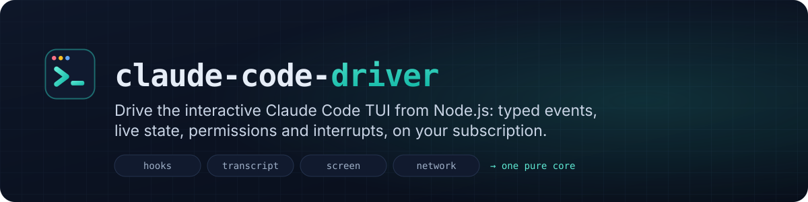
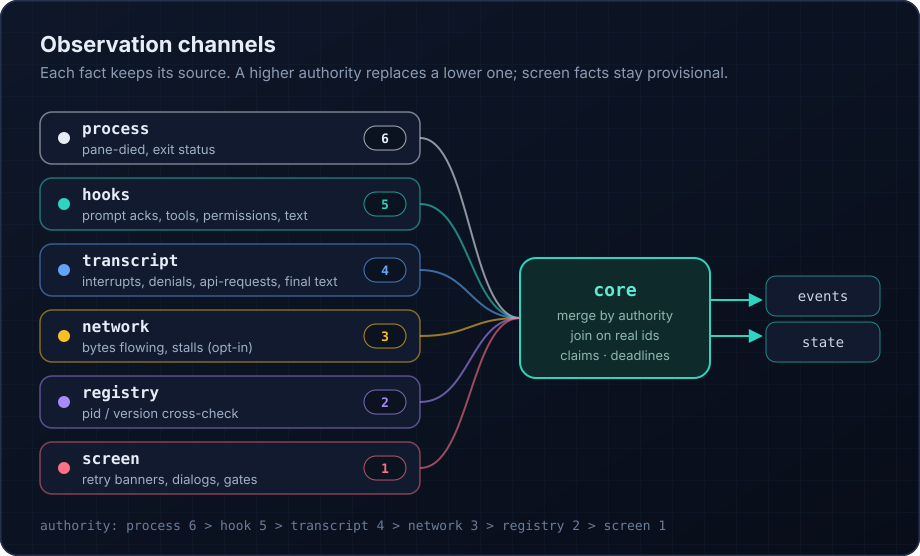

<p align="center"></p>

# claude-code-driver

[](https://github.com/BlitzJB/claude-code-driver/actions/workflows/ci.yml)
[](https://blitzjb.github.io/claude-code-driver/)
[](LICENSE)


**[Documentation](https://blitzjb.github.io/claude-code-driver/)** ·
**[Getting started](https://blitzjb.github.io/claude-code-driver/guide/getting-started)** ·
**[Architecture](ARCHITECTURE.md)** · **[API reference](https://blitzjb.github.io/claude-code-driver/api/)** ·
**[Contributing](CONTRIBUTING.md)**

Drive the **interactive** Claude Code TUI (pinned to **2.1.316**) from Node.js. The TUI runs inside a private tmux server
and you control it with a small typed API: send prompts, answer permission requests, interrupt, change modes, and watch
everything Claude does as one stream of events. You keep your subscription login, you get no API billing and no headless
`-p` mode, and the TUI stays fully visible to a human.

```ts
import { ClaudeSession } from 'claude-code-driver';

await using session = await ClaudeSession.start({
  cwd: '/path/to/a/trusted/project',
  permissions: (req) => (req.toolName === 'Read' ? { behavior: 'allow' } : { behavior: 'deny', message: 'read-only' }),
});

const turn = session.send('Summarise README.md in one sentence.');
for await (const e of turn) if (e.type === 'text') process.stdout.write(e.data.delta);
const result = await turn.done; // { outcome: 'completed', text, tools, durationMs, ... }
```

## How it works



Claude Code is started in a tmux pane on a private socket (`tmux -L ccd-<pid>-<hex>`). The library observes it through
four independent channels and reconciles them into one state machine:

| Channel | What it gives | Source |
|---|---|---|
| **hooks** | prompt acceptance, tool start/end, permission requests, Stop, SessionStart/End, MessageDisplay text | an injected `--settings` file whose hooks call a loopback HTTP server (or a unix-socket forwarder), running in a worker thread |
| **transcript** | the authoritative record: every message, tool result, interrupt marker, `turn_duration`, API errors | poll + `pread` tail of `~/.claude/projects/<slug>/<session>.jsonl` |
| **screen** | dialogs, spinners, retry/stall banners, usage-limit lines, the composer | `tmux capture-pane`, classified by a versioned profile |
| **network** (opt-in) | per-request timing on `api.anthropic.com` tunnels | a CONNECT pass-through sidecar (no TLS interception) |

Input never goes through raw keystrokes: prompts are staged through an `$EDITOR` shim (`Ctrl-G`), so a prompt is never
mistaken for a slash command, bash mode or a paste. Every submission is acknowledged by the `UserPromptSubmit` hook
(or the transcript) before the turn counts as started. A self-test at startup (a blocked nonce prompt) proves the hook
round trip works before the session reports `ready`.

The code is layered (`model → platform → channels → core → session → runtime → api/cli`). The core is a pure,
deterministic reducer, so a recorded session replays byte for byte. See `docs/DESIGN.md`.

## Requirements

- Node.js ≥ 20 (development tooling: Node 22; `.nvmrc`)
- tmux ≥ 3.2 (tested with 3.5a), on `PATH`, in `/opt/homebrew/bin`, `/usr/local/bin` or `/usr/bin`
- Claude Code **2.1.316** (`@anthropic-ai/claude-code`), logged in with a claude.ai subscription
  (`claude auth status` → `authMethod: claude.ai`). API keys and Bedrock/Vertex/gateway providers are refused on purpose.
- macOS or Linux.
- A **trusted** working directory (accepted once in the TUI), or `trust: 'seed'`, which writes only that one trust key
  after inspecting the workspace for risky settings.

## Install

The package is not on npm yet. Build it from source and add it to your project as a local dependency:

```sh
git clone https://github.com/BlitzJB/claude-code-driver.git
cd claude-code-driver && pnpm install && pnpm build      # Node 22 for the tooling (nvm use)
cd /path/to/your/project
pnpm add /path/to/claude-code-driver @anthropic-ai/claude-code@2.1.316
```

The library looks for `claude.exe` in this order: the `claude.bin` option, your project's `node_modules`, its own
`node_modules`, then `PATH`. The version must be exactly 2.1.316 (`claude.expectVersion: 'any'` overrides this, at your own risk).

## The essentials

- `ClaudeSession.start(options)` resolves when Claude is ready (SessionStart seen, composer stable, self-test passed).
  It rejects with a `ClaudeSessionError` (`code`, `details.reason`) and tears everything down on any failure.
- `session.send(prompt)` returns a `Turn`. `turn.accepted` resolves when Claude acknowledged it, and `turn.done` always
  resolves with a `TurnResult`. Iterating the turn yields its events. Prompts that start with `/` are rejected; use
  `session.command('/clear')` for slash commands.
- `permissions` is **required**: `'deny' | 'ask' | 'allowRead' | 'dangerouslyAllowAll'` or a handler. A handler that
  returns `undefined` asks the host through a `permissionRequested` event. Answer it with `respondToPermission`, or let
  the native dialog take over (`onTimeout: 'tui'`).
- `session.usage()` returns current subscription usage (session and weekly %, reset times) read from Claude's `/usage`
  dialog. It costs no model call.
- With `idle: { suspendAfterMs }`, an idle session stops Claude and frees the machine. The next `send()` resumes the same
  conversation first. A pending permission or question always keeps the session live.
- `session.interrupt()` sends one Escape (or denies a held permission with `interrupt:true`). It never sends Ctrl-C.
- `session.close()` waits for background work if you ask, denies held permissions, types `/exit`, then kills the private
  tmux server and removes every file it created. If the host process dies, a detached owner-watch kills Claude and the
  server within 2 s.
- `session.state` is a full `SessionSnapshot`, `session.status` the derived `AgentStatus`. `waitForIdle()`,
  `waitForQuiescence()` and `waitFor(pred)` wait on it.
- Every event carries `provenance` (`confirmed` and its sources). Screen-only evidence is never `confirmed`.
- Errors are `ClaudeSessionError` with one of 18 frozen public codes (`E_CONFIG`, `E_TRUST_REQUIRED`, `E_TURN_FAILED`,
  …), the internal code in `details.reason`, and `retryable`. Test them with `isClaudeSessionError(e, code)`.

See **[docs/USAGE.md](docs/USAGE.md)** for the full guide: options, events, statuses, permissions, errors, usage
queries and limits, recovery, debugging and live tests.

## CLI

```
ccd lifecheck [--state-dir D] [--json]         reap orphaned sessions, write lifecheck.json (idempotent, < 5 s)
ccd lifecheck install|uninstall|status         a LaunchAgent / systemd timer / cron entry that runs it periodically
ccd view <sessionKey> [--exec]                 the read-only `tmux attach -r` command to watch a session
ccd trace replay|explain <file>                inspect a .ccd.jsonl debug trace
```

## Subpath exports

- `claude-code-driver`: the stable API above.
- `claude-code-driver/kernel` (`@experimental`): `createKernel(spec)`, the `SessionKernel` port and its types, for writing
  a different facade. May change in any minor version.
- `claude-code-driver/testing` (`@experimental`): fakes for every port, `createTestKernel`, `replayTrace`.

## Development

```sh
nvm use 22            # dependency-cruiser refuses Node 23
pnpm install
pnpm typecheck && pnpm lint && pnpm test && pnpm build && pnpm check:pkg && pnpm check:api
pnpm test:contract    # real tmux on private sockets, real loopback servers and standalone processes
pnpm test:replay -u   # re-record goldens after an intended behaviour change, then review the diff
node scripts/api-report.mjs --update   # after an intended public API change; review etc/claude-code-driver.api.d.ts
```

Test projects: `unit`, `arch` (layering, timers, `.d.ts` leaks, option isolation), `kernel` (scenarios K-01…K-52 against
the real session/core/channels with every port faked on a FakeClock), `replay` (the `.ccd.jsonl` traces in
`fixtures/traces`, built from the live verification corpus, against `fixtures/goldens`), `contract`, and `live` (gated).

### Live tests

The live tests drive the real Claude 2.1.316 with **your subscription**. CI never runs them.

```sh
pnpm build                                                  # L-08 runs the built package in a child process
CCD_LIVE_MAX_PROMPTS=10 pnpm test:live                      # test:live sets CCD_LIVE=1
CCD_LIVE_NIGHTLY=1 CCD_LIVE_MAX_PROMPTS=15 pnpm test:live   # adds L-06 (background agent), L-10 and L-11 (network)
```

- Prerequisites: a claude.ai subscription login, tmux on `PATH`, the pinned binary in `node_modules`
  (`node_modules/@anthropic-ai/claude-code/bin/claude.exe --version` prints `2.1.316`, otherwise every live test skips),
  and `/private/tmp` trusted in Claude. Sessions run in fresh directories under `/private/tmp/claude-<uid>/ccd-live/<pid>/`
  and inherit that trust.
- Every prompt is tiny (`Reply with the word OK.`). `CCD_LIVE_MAX_PROMPTS` (default 10) is a hard budget shared by all live
  files. A test that would go over it fails instead of sending.
- `CCD_LIVE_TRACE=1` writes one `.ccd.jsonl` trace per session. `CCD_LIVE_KEEP=1` keeps the run directory afterwards.
- The global teardown kills only the tmux servers named in this run's own registry. It never touches another socket.
- Rules for self-hosted runners and the manual sleep/launchd tests are in `docs/MANUAL-TESTS.md`.

## Status and known limits (v1)

- Only Claude Code 2.1.316 is supported. Screen strings and transcript shapes are pinned in
  `src/channels/profiles/claude-2.1.316/`, and a new Claude version needs a new profile.
- Not supported: agent teams, attaching to an existing session, answering MCP elicitations programmatically (they
  surface as `awaitingInput`), `/resume` and `/rewind` inside the pane (use `start({ resume })`), live Bash output.
- Live-verified on 2026-11-03 (L-01…L-11) and 2026-11-04 (L-14, L-15: idle suspend and resume). They cover start → ready with the
  cached self-test, a plain turn, resume in a fresh pane, a handler allow and a TUI deny, the `deny` policy,
  interrupting a running Bash, `/clear`, a background agent's notification turn, a user proxy, owner SIGKILL →
  owner-watch cleanup and resume, and one prompt through the network sidecar. L-13 (hook-worker kill) is skipped, and
  L-11 does not yet test the `refuse` fault.
- Usage-limit handling has not met a real limit yet. Under a managed `allowManagedHooksOnly` policy, the self-test nonce
  reaches the model before `start()` fails.

Every accepted limitation and every open live-probe question is listed in
**[docs/KNOWN-LIMITATIONS.md](docs/KNOWN-LIMITATIONS.md)**.

## Contributing

Contributions are welcome. Start with [CONTRIBUTING.md](CONTRIBUTING.md) and [ARCHITECTURE.md](ARCHITECTURE.md);
please follow the [Code of Conduct](CODE_OF_CONDUCT.md). Report security issues privately as described in
[SECURITY.md](SECURITY.md). Changes are tracked in [CHANGELOG.md](CHANGELOG.md).

## Disclaimer

This is an independent project. It is not affiliated with, endorsed by or supported by Anthropic. It automates the
Claude Code interface you already have access to; you are responsible for using it within the terms of your plan.

## License

[MIT](LICENSE)
