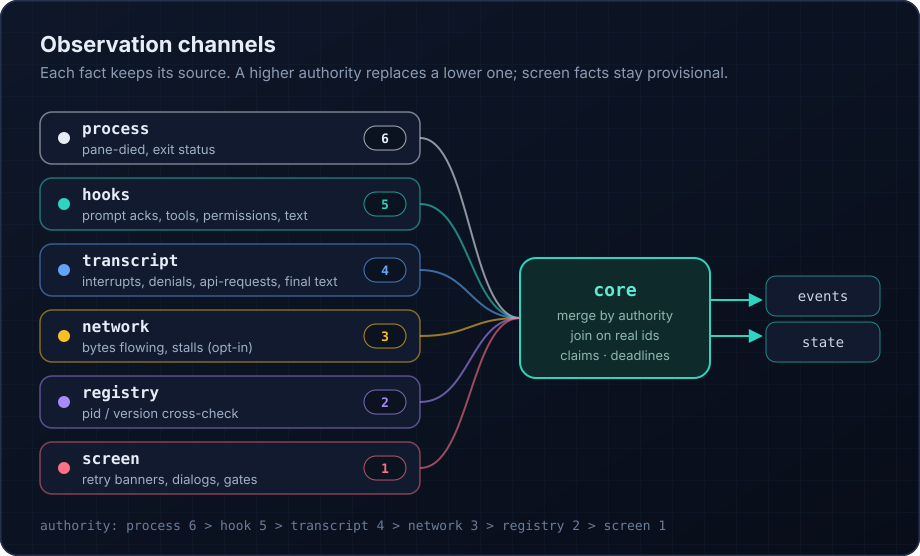

<div class="ccd-home">

<section class="ccd-split">
<div>

## Your code sees what Claude is doing

Hooks report each prompt and tool call as it happens. The transcript confirms what finished. The screen shows
retries and dialogs that nothing else reports. One pure core merges the four sources into events and a live state
snapshot.

```ts
const turn = session.send('Fix the failing test.');
for await (const e of turn) {
  if (e.type === 'toolStarted') {
    console.log(e.data.name);
  }
}
const { outcome } = await turn.done;
```

</div>



</section>

<section class="ccd-promises">
<div>

## What you can rely on

The library makes these guarantees in code and tests them.

</div>
<dl>
<dt>Permissions fail closed.</dt>
<dd>A handler that throws, times out or returns nothing valid denies the request. Closing the session denies any
request still held.</dd>
<dt>Every prompt is acknowledged.</dt>
<dd>A turn starts only after Claude's own UserPromptSubmit hook echoes the exact text you sent.</dd>
<dt>Nothing is left running.</dt>
<dd>If your process dies, a watchdog stops Claude and the tmux server within about two seconds.</dd>
<dt>Recorded traces replay exactly.</dt>
<dd>The core reads no clock and does no I/O, so a trace reproduces the same events and final state on every run.</dd>
<dt>No runtime dependencies.</dt>
<dd>The package is plain TypeScript for Node 20 and later, with Claude Code 2.1.316 pinned as the supported version.</dd>
</dl>
</section>

<section class="ccd-start">
<div>

## Start here

</div>
<div>

Build from source, add it to your project next to the pinned Claude Code, and open a session in a folder you trust.
The [getting started guide](/guide/getting-started) takes about five minutes.

```sh
pnpm add /path/to/claude-code-driver @anthropic-ai/claude-code@2.1.316
```

</div>
</section>

</div>
